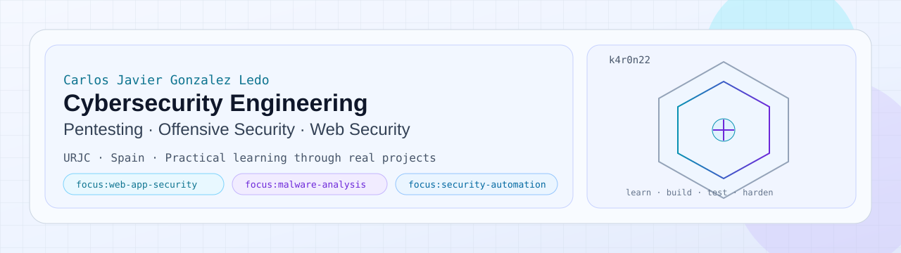

# Carlos Javier Gonzalez Ledo · `k4r0n22`

<picture>
  <source media="(prefers-color-scheme: dark)" srcset="./assets/readme/header-dark.svg">
  
</picture>

  Cybersecurity Engineering Student (URJC) · Pentesting · Offensive Security · Security Automation

  <a href="https://github.com/k4r0n22">GitHub</a> ·
  <a href="https://www.linkedin.com/in/carlos-gonz%C3%A1lez-ledo-32b9b1266/">LinkedIn</a> ·
  <a href="https://tryhackme.com/p/d0v4h">TryHackMe</a> ·
  <a href="https://app.hackthebox.com/profile/d0v4hk1in">Hack The Box</a>

## About me

I am a cybersecurity engineering student at Universidad Rey Juan Carlos (Spain), focused on building practical skills in offensive security. I am especially interested in penetration testing, web application security, vulnerability research, malware analysis, and scripting-driven security automation.

My current objective is to keep developing a credible, hands-on portfolio aligned with junior pentesting and offensive security roles.

## Technical skills

| Area | Stack |
| --- | --- |
| Programming & scripting | `C` · `Python` · `Bash` · `PowerShell` · `JavaScript` · `SQL` |
| Web development | `HTML` · `CSS` · `Node.js` · `Express.js` |
| Security focus | `Web App Security` · `Offensive Security` · `Vulnerability Research` · `Malware Analysis` |
| Tooling & environments | `Linux` · `Kali Linux` · `Burp Suite` · `Git` · `Docker` · `OWASP-oriented workflows` |

## Featured projects

### 1) [cyber_portfolio](https://github.com/k4r0n22/cyber_portfolio)
- **Tech:** HTML, CSS, JavaScript, Node.js, Express.js  
- **What it demonstrates:** Building and structuring a technical portfolio site with a custom front-end and lightweight server setup.

### 2) [mypctracker](https://github.com/k4r0n22/mypctracker)
- **Tech:** PowerShell, Node.js, Express.js, EJS  
- **What it demonstrates:** A script-to-web workflow where a PowerShell client sends endpoint location data to a Node/Express service for visualization.

### 3) [software-ciber-2627](https://github.com/k4r0n22/software-ciber-2627)
- **Tech:** Docker Compose, modular services, collaborative Git workflow  
- **What it demonstrates:** Participation in a team mini-SOC academic project integrating multiple security-related modules in a shared infrastructure.

## Cybersecurity activities

- **TryHackMe:** [d0v4h](https://tryhackme.com/p/d0v4h)  
- **Hack The Box:** [d0v4hk1in](https://app.hackthebox.com/profile/d0v4hk1in)  
- **Competition:** Participated in **Talent4Cyber 2026**, where my team achieved a **top-7** result.

## GitHub activity

  
  

  If the stats widgets are temporarily unavailable, use the repositories tab and contribution graph on my GitHub profile for the canonical activity view.

## Contact

- GitHub: [github.com/k4r0n22](https://github.com/k4r0n22)
- LinkedIn: [Carlos Javier Gonzalez Ledo](https://www.linkedin.com/in/carlos-gonz%C3%A1lez-ledo-32b9b1266/)
