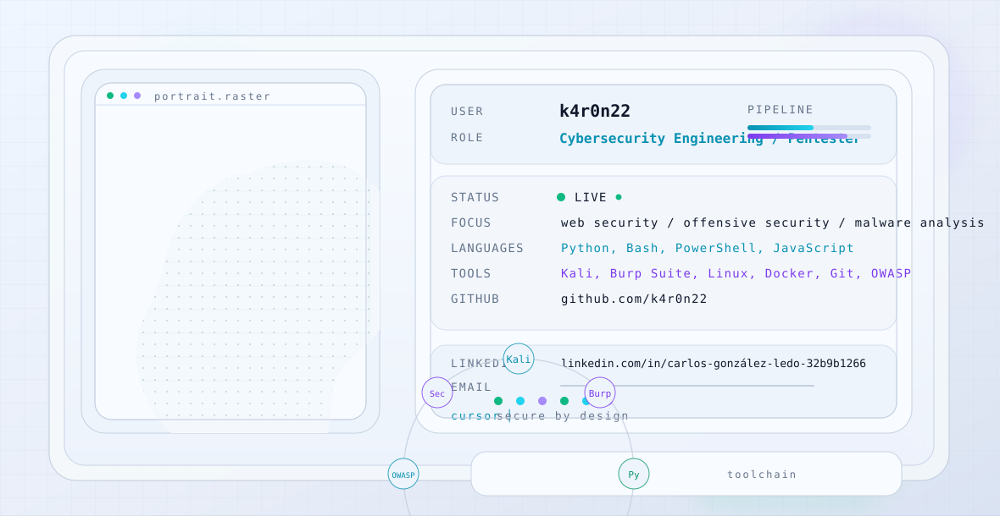

# k4r0n22

<picture>
  <source media="(prefers-color-scheme: dark)" srcset="./dark.svg">
  
</picture>

## Cybersecurity Engineering | Pentesting

> Practical security learning, offensive security, and continuous technical growth.

## About me

I’m a cybersecurity engineering student at Universidad Rey Juan Carlos (URJC), Spain, with a strong interest in offensive security, web application security, scripting, and malware analysis. My work focuses on hands-on learning, security research, and building practical tools that help me understand real attack surfaces, automate security workflows, and improve my technical depth in the field.

## Technical skills

| Category | Skills |
| --- | --- |
| Programming & scripting | C, Python, Bash, PowerShell, JavaScript, SQL |
| Web development | HTML, CSS, Node.js, Express.js |
| Security tools | Linux, Kali Linux, Burp Suite, OWASP |
| Platforms & workflow | Git, Docker, Linux environments, security automation |

## Featured projects

- [cyber_portfolio](https://github.com/k4r0n22/cyber_portfolio) — Personal portfolio website built with HTML, CSS, JavaScript, and a lightweight Node.js/Express server. It reflects a clean, professional web presence and demonstrates front-end design and deployment work.
- [mypctracker](https://github.com/k4r0n22/mypctracker) — PowerShell client plus Node.js/Express backend that sends machine-location data to a web interface for visualization. It demonstrates scripting, automation, and practical web integration.
- [software-ciber-2627](https://github.com/k4r0n22/software-ciber-2627) — Team-built mini-SOC project developed during the URJC cybersecurity software engineering coursework. It brings together containerized security modules and shared monitoring workflows in a practical collaborative environment.

## Cybersecurity learning & competitions

- TryHackMe: [d0v4h](https://tryhackme.com/p/d0v4h)
- Hack The Box: d0v4hk1in
- Talent4Cyber 2026: Team member in a top-7 result in the Talent4Cyber 2026 competition. This was a team achievement and not an individual award.

## GitHub statistics

  
  

## Contact

- GitHub: [k4r0n22](https://github.com/k4r0n22)
- LinkedIn: [Carlos Javier González Ledo](https://www.linkedin.com/in/carlos-gonz%C3%A1lez-ledo-32b9b1266/)

